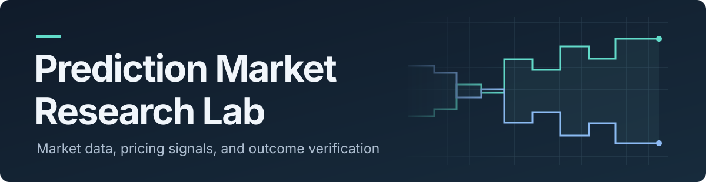
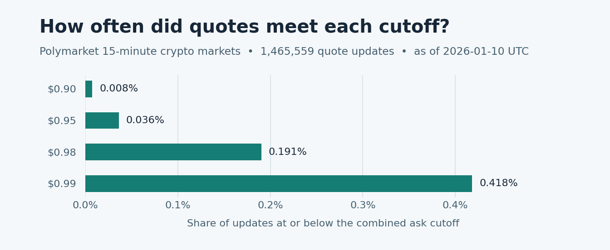
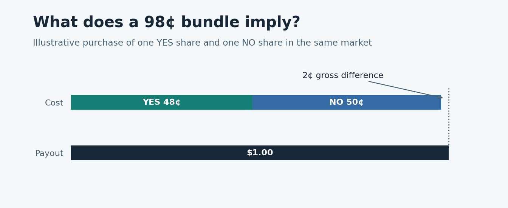

<p align="center">
  
</p>

[](https://github.com/SebastianBoehler/prediction-market-research-lab/actions/workflows/build.yml)
[](https://github.com/SebastianBoehler/prediction-market-research-lab/actions/workflows/cpp-build.yml)
[](LICENSE)

A TypeScript and C++20 workspace for collecting prediction-market quotes,
investigating pricing signals, and checking historical outcomes.

## Research workflow

1. **Collect quotes.** Record market metadata, order books where available, and
   receipt times. The TypeScript collector covers Polymarket and Kalshi.
   The C++ venue scanner collects Limitless and Opinion order books.
2. **Inspect the signal.** Compare YES spreads or the combined cost of buying
   one YES and one NO share. Review each contract's rules before comparing it
   with a contract on another venue.
3. **Check the outcome.** The Polymarket verifier joins observations to final
   resolution payouts by condition ID. Profitability also depends on entry
   prices, fill quality, fees, and settlement.



In the archived Polymarket sample, 2,792 of 1,465,559 quote updates met the
98¢ cutoff. Counts include repeated updates within markets and measure quotes.
[Source CSV](research/archive/summaries/stats-summary.csv) ·
[Figure method](research/README.md)

## Quick start

Clone the repository and run these commands from its root. TypeScript CI uses
[Bun](https://bun.sh/) 1.3.3.

```bash
git clone https://github.com/SebastianBoehler/prediction-market-research-lab.git
cd prediction-market-research-lab
bun install --frozen-lockfile

bun run analyze   # One analysis scan
bun run collect   # Collect until Ctrl+C, writing under data/
```

The TypeScript collector writes JSONL observations and CSV summaries. The
analysis command reports quote patterns and Polymarket–Kalshi contract review
candidates. See [research data and verification](docs/research/research-data.md)
for output schemas and source details.

### C++ venue scans

Install CMake 3.22+, a C++20 compiler, Git, libcurl, OpenSSL, and zlib.
The scanners use public market data and run without wallet credentials.

```bash
bun run cpp:configure
bun run cpp:build

bun run discovery:cpp
mkdir -p data
./cpp/build/research_venues limitless 10 > data/limitless.jsonl
./cpp/build/research_venues opinion 10 > data/opinion.jsonl
```

`discovery_mode` evaluates Polymarket signals and emits paper projections.
`research_venues` records one bounded catalogue sample per invocation and
reports complete quote counts and mean YES spread. See the
[C++ guide](cpp/README.md) for data sources and quote conventions.

### Verify historical outcomes

Collect a Polymarket-only dataset in a fresh output directory with
`INCLUDE_KALSHI=false OUT_DIR=./data/polymarket bun run collect`.

```bash
bun run strategy:nothing-ever-happens -- \
  --csv data/polymarket/market-snapshots-v2.csv --side no --category Sports

bun run strategy:nothing-ever-happens:resolved -- \
  --lookback-hours 336 --limit 2000
```

The CSV verifier writes a report and caches confirmed outcomes under `data/`.
The resolved-history command samples the closed-market feed for the requested
period and limit.

## Reading a pricing signal

Equal shares of complementary YES and NO tokens in the same binary market pay
a combined $1 per pair under standard settlement.



The difference assumes both legs fill at the quoted prices. Fees and slippage
reduce the difference, and one leg can fill by itself. Use the market's current
fee parameters. [Polymarket fee documentation](https://docs.polymarket.com/trading/fees)

## Project map

| Where | What you’ll find |
| --- | --- |
| [`src/`](src/) | TypeScript discovery, collection, analysis, and execution experiments |
| [`cpp/`](cpp/) | Venue scanners, paper projections, and offline tests |
| [`scripts/nothing-ever-happens/`](scripts/nothing-ever-happens/) | Polymarket outcome verification |
| [`docs/research/`](docs/research/) | Research notes, methodology, and roadmap |
| [`research/`](research/) | Historical summaries, plots, and the README figure script |
| `data/` | Local snapshots and generated reports, ignored by Git |

The lab uses [polymarket-cpp-client](https://github.com/SebastianBoehler/polymarket-cpp-client),
[limitless-cpp-client](https://github.com/SebastianBoehler/limitless-cpp-client),
and [opinion-cpp-client](https://github.com/SebastianBoehler/opinion-cpp-client).

## Contributing

See [CONTRIBUTING.md](CONTRIBUTING.md) for offline checks,
[maintenance notes](docs/maintenance.md) for execution compatibility, and
[SECURITY.md](SECURITY.md) for reporting vulnerabilities.

[MIT License](LICENSE). This independent project includes experimental
execution code. Live execution requires separate validation.
