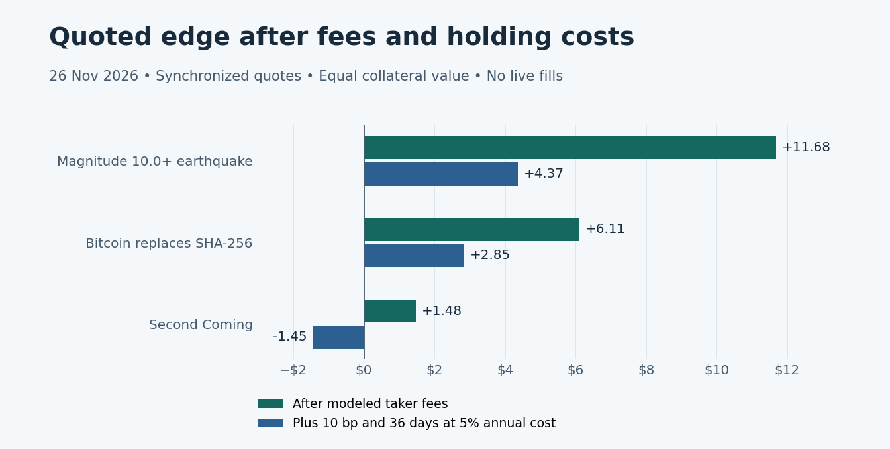
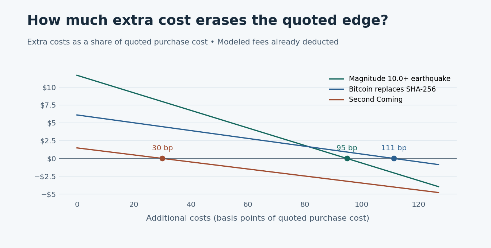

# Cross-platform execution check, 26 November 2026

**None of the three pairs was executable from the tested connection.**
Polymarket's [eligibility endpoint](https://docs.polymarket.com/api-reference/geoblock)
returned `blocked: true`. Each pair requires a Polymarket purchase. No orders
were submitted and there were no fills.

## Quoted economics

The Polymarket and Opinion books still showed the three morning gaps at
10:46–10:47 UTC. The replay used the observed Polymarket YES and Opinion NO
ask ladders and paired equal quoted quantities. It accepted eight snapshots
with book receipts within one second. One SHA-256 scan exceeded that window.
The accepted snapshots repeated the same depth within each pair.

| Pair | Quoted cost | Gross edge | After modeled taker fees | Extra-cost budget | Illustrative after-cost result |
| --- | ---: | ---: | ---: | ---: | ---: |
| Magnitude 10.0+ earthquake before 2027 | $1,231.62 | $23.85 | +$11.68 | 94.8 bp | +$4.37 |
| Bitcoin replaces SHA-256 before 2027 | $548.89 | $11.78 | +$6.11 | 111.2 bp | +$2.85 |
| Second Coming before 2027 | $493.61 | $6.59 | +$1.48 | 30.0 bp | −$1.45 |

A basis point (bp) is 0.01% of the quoted purchase cost. The extra-cost
budget is the modeled edge divided by that cost. The last column deducts
10 bp for conversion and transfers plus simple funding cost at 5% annualized
for 36 days. These are scenario inputs. The actual funding route, conversion
rate, and time to redeem depend on balances and venue settlement. Delayed
resolution can extend the hold.

## Execution constraints

- **Order minimums and market status.** All three Polymarket markets were
  accepting orders and the CLOB reported a five-share minimum and 0.001
  price tick. Opinion reported the three markets active. The modeled full
  depths cleared Opinion's published $5 order minimum. Quote quantities
  remain fractional model inputs.
- **Market fees.** The Polymarket CLOB and Gamma agreed on fee schedules.
  The earthquake market had fees disabled, and SHA-256 and Second Coming
  had curve coefficients of 0.01 and 0.05, respectively. The Opinion replay
  applies its published 1% effective fee cap and $0.25 floor per matched
  fill, with one fill per visible price level. The public fee-rate endpoint
  returned zero basis points for all three tokens and for a token-ID-zero
  control. That response leaves the account-specific fee and minimum
  charge unresolved.
- **Fill count and quantities.** At the modeled full depth, a conservative
  fee bound allows up to 46, 25, and 5 Opinion fills respectively before
  conversion and funding costs. The public book aggregates orders by
  price. Opinion also documents that the final on-chain USDT or share
  amount can change when a fee applies. The replay assumes fees are cash
  costs and that the full paired share quantities are retained.
- **One-leg exposure.** Polymarket offers fill-or-kill for its own order.
  Opinion documents partial fills and an on-chain confirmation after
  matching. The two venues settle independently, so one leg can be left
  open. Both legs need confirmed net quantities and compatible payouts.
  Cross-venue fills and matched payout have no live verification here.

[Polymarket fees](https://docs.polymarket.com/trading/fees) ·
[Polymarket order types](https://docs.polymarket.com/trading/place-orders) ·
[Opinion fees](https://docs.opinion.trade/trade-on-opinion.trade/fees.md) ·
[Opinion order book](https://docs.opinion.trade/trade-on-opinion.trade/trade-on-prediction-market/understanding-the-order-book) ·
[Opinion fill confirmation](https://docs.opinion.trade/developer-guide/opinion-websocket/user-channels)

## Research context

The overnight run collected 11,847 catalogue observations across Polymarket,
Kalshi, Limitless, and Opinion. The SHA-256 pair repeated the same quoted
discount in 274 synchronized snapshots. The next morning's targeted search
found 11 more pairs with matching rules. The earthquake and Second Coming
pairs showed positive fee replays. The five matched Polymarket–Limitless
December Fed buckets had no gross discount, and no Kalshi pair qualified in
that sample. The pooled 60-second signal did not beat the unchanged-price
baseline on any catalogue venue over the overnight window.

[Derived summary CSV](../../research/archive/summaries/cross-platform-execution-2026-11-26.csv) ·
[Figure renderer](../../research/render_execution_figures.py)
